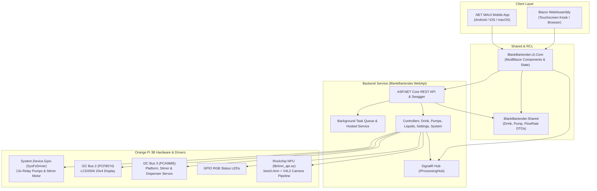

# BlankBartender 🍸🤖

[](https://dotnet.microsoft.com/)
[](https://dotnet.microsoft.com/apps/aspnet/web-apps/blazor)
[](https://dotnet.microsoft.com/apps/maui)
[](https://mudblazor.com/)
[](http://www.orangepi.org/)
[](https://github.com/rockchip-linux/rknn-toolkit2)
[](LICENSE)

**BlankBartender** is an intelligent, automated cocktail mixing and drink dispensing machine powered by **.NET 9**. Built for single-board computers (specifically the **Orange Pi 3B** with Rockchip RK3566), it combines embedded GPIO/I2C hardware control, edge AI computer vision for glassware detection, motorized mechanical stages (ice dispenser, platform motion, motorized stirrer), and cross-platform clients (Blazor WebAssembly & .NET MAUI mobile app).

---

## 📑 Table of Contents

- [Features](#-features)
- [System Architecture](#-system-architecture)
- [Hardware & Pinout](#-hardware--pinout)
  - [Orange Pi 3B Wiring Guide](#orange-pi-3b-wiring-guide)
  - [Hardware Components](#hardware-components)
- [Project Structure](#-project-structure)
- [Software Stack & Technologies](#-software-stack--technologies)
- [Configuration](#-configuration)
- [Getting Started](#-getting-started)
  - [Prerequisites](#prerequisites)
  - [Local Development (Simulation / Debug Mode)](#local-development-simulation--debug-mode)
  - [Deployment to Orange Pi / Linux ARM64](#deployment-to-orange-pi--linux-arm64)
- [API Overview](#-api-overview)
- [Roadmap & Enhancements](#-roadmap--enhancements)
- [License](#-license)

---

## ✨ Features

- **13-Pump Precision Dispensing**: Calibrated flow-rate dispensing (`ml/s`) across 13 relay-driven liquid channels for spirits, mixers, and syrups.
- **Edge AI Glassware Detection**: Built-in computer vision using OpenCvSharp and Rockchip NPU (`RKNN`) running a custom YOLO model (`best3.rknn`) detecting 10 glassware classes (Martini, Highball, Rocks glass, Shot glass, etc.) before dispensing.
- **Motorized Servos & Smooth Motion**: PCA9685 16-channel I2C PWM controller with sinusoidal ease-in/ease-out mathematical motion curves to smoothly transport glasses between stations without spilling.
- **Motorized Stirring & Ice Dispensing**: Actuated arm servo lowers the stirrer into the cocktail, spins the stirring motor, and safely retracts.
- **Physical Feedback & Display**:
  - 20x4 I2C Character LCD (`LCD2004` via `PCF8574`) showing status, real-time countdown, and user instructions.
  - RGB Status Lights (Red, Green, Blue) indicating machine readiness, active pouring, and alerts.
- **Real-Time Client Synchronization**: SignalR hub (`/ProcessingHub`) streams live state across all connected touchscreens and mobile devices.
- **Modern Responsive UI (MudBlazor)**:
  - Cocktail gallery with instant search, category filters (All, Alcoholic, Non-Alcoholic).
  - "Mix Your Own" custom drink builder with volume sliders.
  - Interactive drink customization (adjust proportions on the fly).
  - Comprehensive **Maintenance Panel**: prime lines ("Initialize Flow"), individual pump jog testing, liquid reassignment, and hardware toggle switches.
- **Dual Frontend Delivery**:
  - **Web Application**: Blazor WebAssembly for kiosk touchscreens and web browsers.
  - **Mobile Application**: .NET MAUI Blazor Hybrid targeting Android, iOS, and macOS.

---

## 🏛 System Architecture



---

## 🔌 Hardware & Pinout

BlankBartender is optimized for the **Orange Pi 3B** single-board computer (Rockchip RK3566).

### Orange Pi 3B Wiring Guide

| Function | Physical Pin | Logical GPIO / Interface | Description |
| :--- | :---: | :---: | :--- |
| **I2C-2 SDA** | Pin 3 | `GPIO 140` (SDA.2) | PCF8574 Display Controller Data |
| **I2C-2 SCL** | Pin 5 | `GPIO 141` (SCL.2) | PCF8574 Display Controller Clock |
| **Stirrer DC Motor** | Pin 7 | `GPIO 147` | Stirring Motor Relay / MOSFET |
| **Pump 1** | Pin 11 | `GPIO 118` | Dispenser Pump 1 Relay |
| **Pump 13** | Pin 12 | `GPIO 119` | Dispenser Pump 13 Relay |
| **Pump 2** | Pin 13 | `GPIO 128` | Dispenser Pump 2 Relay |
| **Pump 3** | Pin 15 | `GPIO 130` | Dispenser Pump 3 Relay |
| **Pump 4** | Pin 16 | `GPIO 131` | Dispenser Pump 4 Relay |
| **Pump 5** | Pin 18 | `GPIO 129` | Dispenser Pump 5 Relay |
| **Pump 6** | Pin 22 | `GPIO 132` | Dispenser Pump 6 Relay |
| **I2C-3 SDA** | Pin 27 | `GPIO 32` (SDA.3) | PCA9685 PWM Driver Data |
| **I2C-3 SCL** | Pin 28 | `GPIO 33` (SCL.3) | PCA9685 PWM Driver Clock |
| **Pump 7** | Pin 29 | `GPIO 133` | Dispenser Pump 7 Relay |
| **Pump 8** | Pin 31 | `GPIO 124` | Dispenser Pump 8 Relay |
| **Pump 9** | Pin 32 | `GPIO 144` | Dispenser Pump 9 Relay |
| **Red Light** | Pin 33 | `GPIO 127` | Red Status LED Indicator |
| **Green Light** | Pin 35 | `GPIO 120` | Green Status LED Indicator |
| **Pump 10** | Pin 36 | `GPIO 125` | Dispenser Pump 10 Relay |
| **Blue Light** | Pin 37 | `GPIO 123` | Blue Status LED Indicator |
| **Pump 11** | Pin 38 | `GPIO 122` | Dispenser Pump 11 Relay |
| **Pump 12** | Pin 40 | `GPIO 121` | Dispenser Pump 12 Relay |

### PCA9685 PWM Servo Channels (I2C Bus 3, `0x40`)

- **Channel 1**: Stirrer Arm Servo (vertical up/down actuation)
- **Channel 7**: Platform Servo (horizontal rail positioning: Home ↔ Ice ↔ Stirrer)
- **Channel 8**: Ice / Garnish Dispenser Servo (300° angle movement)

### Hardware Components

1. **Single Board Computer**: Orange Pi 3B (Rockchip RK3566, 4GB/8GB RAM recommended) running Armbian / Debian / Ubuntu Linux.
2. **Pumps**: 12V 385/peristaltic food-grade liquid pumps (13 units).
3. **Relay Boards**: 16-channel optocoupled active-low relay module or MOSFET switching board.
4. **Display**: 20x4 LCD with PCF8574 I2C backpack (`0x27`).
5. **Servo Driver**: PCA9685 16-channel 12-bit PWM controller (`0x40`).
6. **Servos**: Standard MG996R or high-torque metal-gear servos for platform and stirrer arm.
7. **Camera**: V4L2 USB camera or MIPI-CSI camera module mounted above the drink platform (`/dev/video0`).
8. **Power Supply**: 12V DC power supply (minimum 10A for pumps) with a step-down buck converter (5V 4A) for SBC and servos.

---

## 📁 Project Structure

```text
BlankBartender/
├── BlankBartender.sln
├── LICENSE
├── README.md
└── src/
    ├── BlankBartender.Shared/             # Domain DTOs (Drink, Pump, FlowRate, Light)
    ├── BlankBartender.UI/
    │   ├── BlankBartender.UI.Core/        # Razor Class Library: MudBlazor pages & components
    │   │   ├── Pages/                     # LandingPage, AllCocktails, Maintenance, AddCocktail, etc.
    │   │   ├── Shared/                    # CocktailCard, HeaderWithSearch, MainLayout, Theme
    │   │   ├── Services/                  # DrinkService, ConfigurationService, StatusService
    │   │   └── Http/                      # NSwag-generated ApiClient.Generated.cs
    │   ├── BlankBartender.UI.Web/         # Blazor WebAssembly project
    │   └── BlankBartender.UI.Mobile/      # .NET MAUI Blazor Hybrid app (Android / iOS / macOS)
    └── BlankBartender.WebApi/             # ASP.NET Core backend & hardware services
        ├── Configuration/                 # Configuration paths and options
        ├── ConfigurationData/             # JSON configs (drinks, liquids, pumps, lights, settings)
        ├── Controllers/                   # DrinkController, PumpsController, LiquidsController, etc.
        ├── External/                      # RKNN C-API P/Invoke and model bindings
        ├── Notification/                  # SignalR ProcessingHub
        ├── Repositories/                  # Liquids and Pumps file repositories
        ├── Services/                      # GPIO, PWM, LCD Display, AI Detection, Cocktail services
        ├── WorkerQueues/                  # Asynchronous sequential background task queues
        ├── best3.rknn                     # Compiled YOLO glass detection model for RKNN NPU
        └── coco_80_labels_list.txt        # Glass category labels list
```

---

## 🛠 Software Stack & Technologies

- **Runtime**: [.NET 9.0](https://dotnet.microsoft.com/download/dotnet/9.0)
- **Frameworks**:
  - ASP.NET Core Web API
  - Blazor WebAssembly
  - .NET MAUI Blazor Hybrid
- **UI & Styling**:
  - [MudBlazor 8](https://mudblazor.com/) (Material Design components)
  - Custom dark theme optimized for bar environments
- **IoT & Hardware Integration**:
  - `System.Device.Gpio` with `SysFsDriver`
  - `Iot.Device.Bindings` (Pcf8574, Lcd2004, Pca9685)
- **Computer Vision & Machine Learning**:
  - [OpenCvSharp4](https://github.com/shimat/opencvsharp)
  - Rockchip RKNN Toolkit2 Runtime (`librknn_api.so`)
  - YOLOv5 / YOLOv8 converted RKNN model (`best3.rknn`)
- **API Tooling & Communication**:
  - SignalR (Real-time updates)
  - NSwag (OpenAPI / Swagger generation and client codegen)
  - Polly (Resilient HTTP policies)

---

## ⚙ Configuration

All hardware assignments and drink definitions reside in `src/BlankBartender.WebApi/ConfigurationData/`:

1. **`pump-config.json`**:
   Configures pump number, logical GPIO pin, connected liquid name, and measured flow rate:
   ```json
   {
     "pumps": [
       {
         "number": 1,
         "pin": 118,
         "value": "Absinthe",
         "flowRate": 5.0,
         "time": null
       }
     ]
   }
   ```

2. **`settings.json`**:
   Toggles hardware capabilities:
   ```json
   {
     "useCameraAI": false,
     "useStirrer": false,
     "useIceDispenser": true
   }
   ```

3. **`drink-config.json`**:
   Contains cocktail recipes with ingredients (in ml) and garnishes.

4. **`liquids-config.json`**:
   Master list of all liquids recognized by the system.

5. **`lights-config.json`**:
   GPIO pins mapped to status LEDs:
   ```json
   {
     "lights": [
       { "name": "blue", "pin": 123 },
       { "name": "green", "pin": 120 },
       { "name": "red", "pin": 127 }
     ]
   }
   ```

---

## 🚀 Getting Started

### Prerequisites

- [.NET 9.0 SDK](https://dotnet.microsoft.com/download/dotnet/9.0)
- Optional for mobile: .NET MAUI workload (`dotnet workload install maui`)
- Linux ARM64 system libraries (on Orange Pi):
  - `librknn_api.so` (placed in system library path `/usr/lib/` or app directory)
  - `gstreamer1.0-plugins-good`, `gstreamer1.0-plugins-bad`, `v4l-utils`

### Local Development (Simulation / Debug Mode)

In `Debug` configuration, hardware controllers and AI detection are mocked:
- GPIO writes and I2C commands are bypassed.
- AI detection automatically succeeds.
- Web API starts on `http://localhost:5000`.

1. **Clone the repository**:
   ```bash
   git clone https://github.com/prixes/BlankBartender.git
   cd BlankBartender
   ```

2. **Run the Web API**:
   ```bash
   dotnet run --project src/BlankBartender.WebApi/BlankBartender.WebApi.csproj
   ```
   Navigate to `http://localhost:5000/swagger` to inspect the Swagger UI.

3. **Run the Blazor Web Client**:
   ```bash
   dotnet run --project src/BlankBartender.UI/BlankBartender.UI.Web/BlankBartender.UI.Web.csproj
   ```
   Access the frontend interface in your browser.

4. **Run the Mobile App (Android / iOS)**:
   ```bash
   dotnet build src/BlankBartender.UI/BlankBartender.UI.Mobile/BlankBartender.UI.Mobile.csproj -t:Run -f net9.0-android
   ```

### Deployment to Orange Pi / Linux ARM64

To publish and deploy the backend for the Orange Pi 3B:

1. **Publish Release build for linux-arm64**:
   ```bash
   dotnet publish src/BlankBartender.WebApi/BlankBartender.WebApi.csproj \
     -c Release \
     -r linux-arm64 \
     --self-contained false \
     -o ./publish/webapi
   ```

2. **Copy to Orange Pi**:
   ```bash
   scp -r ./publish/webapi user@orangepi.local:/home/user/blankbartender
   ```

3. **Run with Systemd Service**:
   Create `/etc/systemd/system/blankbartender.service`:
   ```ini
   [Unit]
   Description=BlankBartender Web API Service
   After=network.target

   [Service]
   WorkingDirectory=/home/user/blankbartender
   ExecStart=/usr/bin/dotnet /home/user/blankbartender/BlankBartender.WebApi.dll
   Restart=always
   RestartSec=5
   User=root
   Environment=ASPNETCORE_ENVIRONMENT=Production
   Environment=DOTNET_PRINT_TELEMETRY_MESSAGE=false

   [Install]
   WantedBy=multi-user.target
   ```
   *(Note: `root` or `gpio` group membership is required for raw SysFs/I2C access).*

4. **Start the service**:
   ```bash
   sudo systemctl daemon-reload
   sudo systemctl enable --now blankbartender
   ```

---

## 📡 API Overview

| Method | Endpoint | Description |
| :--- | :--- | :--- |
| `GET` | `/Drink/all` | Retrieve all registered cocktails |
| `GET` | `/Drink/available/all` | Retrieve cocktails currently craftable based on connected pump liquids |
| `GET` | `/Drink/make/cocktail/{id}` | Dispense a cocktail recipe by ID |
| `POST` | `/Drink/make/cocktail/custom` | Dispense a customized or ad-hoc cocktail recipe |
| `POST` | `/Drink/cocktail/create` | Save a new cocktail recipe to catalog |
| `GET` | `/configuration/pumps/liquids/available` | Get list of currently connected liquids |
| `GET` | `/configuration/pump` | Get full pump assignment configuration |
| `PUT` | `/configuration/pump/change` | Reassign liquid to a specific pump number |
| `POST` | `/configuration/pumps/all/start` | Start all pumps (continuous jog mode) |
| `POST` | `/configuration/pumps/all/stop` | Stop all pumps |
| `POST` | `/configuration/pump/{pumpNumber}/start` | Jog individual pump |
| `POST` | `/configuration/pump/{pumpNumber}/stop` | Stop individual pump |
| `POST` | `/configuration/initialize` | Prime lines with timed pump pulses |
| `GET` | `/configuration/settings` | Get hardware switch settings (AI, Stirrer, Ice) |
| `PUT` | `/configuration/settings` | Update hardware switch settings |
| `WS` | `/ProcessingHub` | SignalR Hub for real-time status streaming |

---

## 🗺 Roadmap & Enhancements

- [ ] Clean up NSwag post-build targets to use localized CLI / MSBuild tasks.
- [ ] Migrate `SysFsDriver` to `LibGpiodDriver` (standard for modern Linux kernels >= 5.x).
- [ ] Centralize configuration access via DI options pattern / unified repository.
- [ ] Add hardware calibration wizard in Maintenance UI (ml per second calibration per pump).
- [ ] Inventory volume tracking (notify when bottles are running low).
- [ ] User profiles and favorite drink bookmarks.

---

## 📄 License

This project is licensed under the **GNU General Public License v3.0 (GPL-3.0)** — see the [LICENSE](LICENSE) file for details.